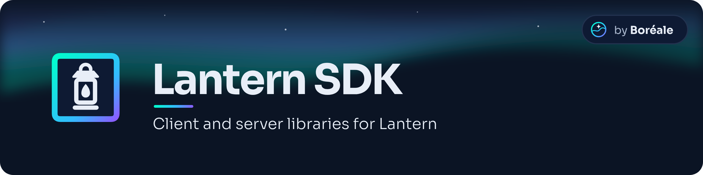

<div align="center">



### One protocol between your console homebrews and your own library server

**C++23 · C · Python · TypeScript · Go · Rust**

[](https://github.com/JigSawFr/lantern-sdk/actions/workflows/ci.yml)
[](https://lantern.boreale.dev/?utm_source=github&utm_medium=readme)
[](LICENSES/MIT.txt)

[**Specification**](https://lantern.boreale.dev/?utm_source=github&utm_medium=readme) ·
[**Packages**](#-packages) ·
[**Quick&nbsp;start**](#-quick-start) ·
[**Families**](#-families-by-language) ·
[**Releases**](#-releases)

</div>

---

Client and server libraries for the [Lantern protocol](https://github.com/JigSawFr/lantern), the open, versioned REST/JSON protocol between console homebrews and the library servers people run at home for their own games. The specification lives at [lantern.boreale.dev](https://lantern.boreale.dev/?utm_source=github&utm_medium=readme) and is pinned here as a submodule; the libraries share the same types, generated from its schemas.

> [!WARNING]
> **Draft 0.11, nothing released yet.** The protocol and these APIs change until 1.0. The libraries are complete for the draft and pass its conformance suite in CI, but no package is published before the first release.

## ✨ Features

- 📱 **A whole client** — pairing with a device key, requests signed by it (RFC 9421), listings, `missing`, verified and resumable downloads, writes, events, mirrors and peers, sync, end-to-end encrypted saves, differential updates, static libraries.
- 🖥️ **A server toolkit** — add Lantern to an existing server (Flask, FastAPI, Hono or `node:http`) or to your own, up to **Lantern Core +titles +homebrew +saves +cheats +requests +admin +events +peers +sync +encrypted_saves +deltas**.
- 🧬 **One set of types** — generated from the specification's schemas, the same in every language.
- 🛡️ **Distrustful by default** — HTTPS with the server's key pinned, a `.part` file renamed only when the SHA-256 matches, a `schema` newer than the library's treated as absent.
- 🧪 **Tested against the worst** — every server passes the specification's conformance suite, every client a deliberately malicious test server, in CI, for every language.
- 🔗 **Swift and Kotlin too** — a thin, stable C ABI over the C++ client, checked in CI.
- 🗂️ **Static libraries** — a read-only library as JSON files (GitHub Pages, a NAS, a USB stick), and the generator that writes it.
- 🔏 **Signed releases** — built from the tag by CI, reproducibly, with an SBOM and SLSA provenance.

## 📦 Packages

| Folder | Language | What it is |
|---|---|---|
| [`cpp/`](cpp/README.md) | C++23 | The client of consoles and of apps built with [Aurore](https://github.com/JigSawFr/Aurore), a server core and a peer's side; libcurl and mbedTLS transports |
| [`c/`](c/README.md) | C | A C ABI over the C++ client, for Swift and Kotlin (JNI); documents read through accessors generated from the schemas |
| [`python/`](python/README.md) | Python 3.11+ | `lantern-protocol`: the client (sync and async), a server toolkit with Flask and FastAPI adapters, the generator of static libraries, the malicious test server |
| [`typescript/`](typescript/README.md) | TypeScript | `lantern-protocol`: the client for browsers and Node, with no runtime dependency, and a server toolkit for Node and web Requests (Hono) |
| [`go/`](go/README.md) | Go 1.24+ | `github.com/JigSawFr/lantern-sdk/go`: being built, family by family. So far the documents of the specification as typed values, their validation against its schemas, canonical JSON, digests and errors; no client or server yet |
| [`rust/`](rust/README.md) | Rust 1.90+ | `lantern-protocol`: the documents as typed structs generated from the schemas, the core without input or output (canonical JSON, digests, key fingerprints, limits, problems, profiles), signed requests, and a client over a `Transport` (handshake, apps, pairing, downloads); an HTTP transport with the server's key pinned (feature `http`); LAN discovery (the datagram); DNS-SD, the rest of the client and the server toolkit follow, in slices |

Each folder's README has the details: installing, every call, what is not there yet.

## 🚀 Quick start

Read a library, in each language. Servers and names are made up.

<details open>
<summary><b>Python</b></summary>

```sh
pip install lantern-protocol   # at the first release
```

```python
import lantern

with lantern.LanternClient(
    "https://shelf.example.org/", platform="switch", user_agent="MyShelf/1.0", token=TOKEN
) as client:
    hello = client.handshake()                 # the server, the account, the families offered
    for app in client.iter_apps(type="base"):  # every page, cursor by cursor
        print(app.name, app.version_code)
```

</details>

<details>
<summary><b>TypeScript</b></summary>

```sh
npm install lantern-protocol   # at the first release
```

```ts
import { NodeLanternClient } from "lantern-protocol/node";

const client = new NodeLanternClient("https://shelf.example.org/", {
  platform: "switch",
  userAgent: "MyShelf/1.0",
  token: TOKEN,
});
const hello = await client.handshake(); // the server, the account, the families offered
for await (const app of client.iterApps({ type: "base" })) console.log(app.name, app.version_code);
```

</details>

<details>
<summary><b>C++</b></summary>

```sh
cd cpp && cmake --workflow --preset dev   # configure, build, run the tests
```

```cpp
lantern::ClientConfig config;
config.origin     = "https://shelf.example.org";
config.user_agent = "MyShelf/1.0";
config.platform   = "switch";
auto client = lantern::Client::create(transport, config);

const auto server = client->handshake();   // name, base path, features
const auto page   = client->apps();
```

A complete example, with paging and a verified download: [`cpp/examples/read_library.cpp`](cpp/examples/read_library.cpp).

</details>

More: [`python/examples/`](python/examples/), [`typescript/examples/`](typescript/examples/), [`cpp/examples/`](cpp/examples/), [`c/examples/`](c/examples/).

<details>
<summary><b>Add Lantern to a Flask app</b></summary>

```python
from flask import Flask
from lantern.server import Account, LanternApp, MemoryLibrary
from lantern.server.flask import init_app

library = MemoryLibrary(base="/api/lantern")   # or your own Library: apps, titles, files…
app = Flask(__name__)
init_app(app, LanternApp(library, uid=SERVER_UID, name="Living room shelf", authenticate=authenticate, secret=SECRET))
```

FastAPI is `lantern.server.fastapi.include(app, lantern_app)`; in Node, `LanternApp` runs on `node:http` or on any framework of web Requests.

</details>

## 🧩 Families by language

Each family of the specification (SPEC.md § 4.2), read as a client and served (client / server): ✓ yes, – no, ◐ part of it. C++ has a peer's side (`PeerGate`, § 19.4) and the first slices of a server core (the library family with its `titles`, `changes`, `sections` and `homebrew`, and the `cheats` sets, written with the scope `cheats.write`, read anonymously or with a token; the `saves` backups, `requests` for games, `pairing` with invitations and `signatures`, and the `admin` API (accounts, devices, pairings, invitations, rating caps, deleting an account, deciding requests); the `events`, a stream and the long poll of `changes`; the grants of `peers` and the `sync` collections; the chunk indexes of `deltas`; all with their conformance run in CI, so ◐ until `tools/check_matrix.py` knows that run; the other families follow), and the C API wraps the C++ client. Rust is being built, a slice at a time ([`rust/`](rust/README.md)): its column is – until a family is read and served, with its conformance run in CI. CI checks the rows against the Python and TypeScript libraries' families and against what their demo servers offer ([`tools/check_matrix.py`](tools/check_matrix.py)); a server marked ✓ is one whose conformance suite runs in CI.

<!-- families:start -->
| Family | C++ | C | Python | TypeScript | Go | Rust |
|---|---|---|---|---|---|---|
| `library` | ✓ / ◐ | ✓ / – | ✓ / ✓ | ✓ / ✓ | ✓ / – | – / – |
| `titles` | ✓ / ◐ | ✓ / – | ✓ / ✓ | ✓ / ✓ | ✓ / – | – / – |
| `changes` | ✓ / ◐ | ✓ / – | ✓ / ✓ | ✓ / ✓ | ✓ / – | – / – |
| `sections` | ✓ / ◐ | ✓ / – | ✓ / ✓ | ✓ / ✓ | – / – | – / – |
| `homebrew` | ✓ / ◐ | ✓ / – | ✓ / ✓ | ✓ / ✓ | ✓ / – | – / – |
| `saves` | ✓ / ◐ | ✓ / – | ✓ / ✓ | ✓ / ✓ | ✓ / – | – / – |
| `cheats` | ✓ / ◐ | ✓ / – | ✓ / ✓ | ✓ / ✓ | ✓ / – | – / – |
| `requests` | ✓ / ◐ | ✓ / – | ✓ / ✓ | ✓ / ✓ | ✓ / – | – / – |
| `pairing` | ✓ / ◐ | ✓ / – | ✓ / ✓ | ✓ / ✓ | ✓ / – | – / – |
| `signatures` | ✓ / ◐ | ✓ / – | ✓ / ✓ | ✓ / ✓ | ✓ / – | – / – |
| `admin` | ✓ / ◐ | ✓ / – | ✓ / ✓ | ✓ / ✓ | ✓ / – | – / – |
| `events` | ✓ / ◐ | ✓ / – | ✓ / ✓ | ✓ / ✓ | ✓ / – | – / – |
| `peers` | ✓ / ◐ | ✓ / – | ✓ / ✓ | ✓ / ✓ | ✓ / – | – / – |
| `sync` | ✓ / ◐ | ✓ / – | ✓ / ✓ | ✓ / ✓ | ✓ / – | – / – |
| `encrypted_saves` | ✓ / ◐ | ✓ / – | ✓ / ✓ | ✓ / ✓ | ✓ / – | – / – |
| `deltas` | ✓ / ◐ | ✓ / – | ✓ / ✓ | ✓ / ✓ | – / – | – / – |
<!-- families:end -->

`sdk.json` says all this, and the versions, the levels each server reaches and the examples, to [the site's SDK page](https://lantern.boreale.dev/sdk/?utm_source=github&utm_medium=readme); [`tools/site_data.py`](tools/site_data.py) writes it from the sources and CI checks it.

## 📦 Releases

Nothing is released yet. One version for the whole SDK, the same in every language, with notes by language: the C++ library and the C API as source and as CMake packages built for Linux x86_64, the Python package `lantern-protocol` on PyPI and the npm package `lantern-protocol`, all on [the releases page](https://github.com/JigSawFr/lantern-sdk/releases). Every file is built by this repository's CI from the tag, reproducibly, with its SBOM, and attested (SLSA build provenance, through Sigstore); the packages are published by trusted publishing, without any token. [SECURITY.md](SECURITY.md#verifying-a-release) says how to check a file, [RELEASING.md](RELEASING.md) how a release is made.

## 🤝 Contributing

[CONTRIBUTING.md](CONTRIBUTING.md) · [Releasing](RELEASING.md) · [Code of conduct](CODE_OF_CONDUCT.md) · [Security](SECURITY.md)

Issues and pull requests go on this repository. A change to the protocol itself is proposed in [the specification's repository](https://github.com/JigSawFr/lantern). A security flaw is reported privately, as [SECURITY.md](SECURITY.md) says.

## 🧭 How it's made

[](https://boreale.dev/how/?utm_source=github&utm_medium=readme)

Lantern SDK is built by [JigSawFr](https://github.com/JigSawFr), a full-stack
engineer who has shipped production software for years, with AI coding
assistants as part of the toolbox.

- **I decide**: architecture, scope, what ships and what doesn't.
- **AI helps write**: first drafts of code and tests, docs, and the translations.
- **I review everything**: every change is read, tested and signed before it
  reaches `main`.

Nothing in these libraries calls an AI service. More on [boreale.dev](https://boreale.dev/how/?utm_source=github&utm_medium=readme).

## 📜 License and credits

**MIT**, see [`LICENSES/MIT.txt`](LICENSES/MIT.txt); every file says its licence ([REUSE](https://reuse.software/)). Maintained by [JigSawFr](https://github.com/JigSawFr), part of [Boréale](https://boreale.dev/?utm_source=github&utm_medium=readme) with [PlayGuard](https://github.com/JigSawFr/PlayGuard), [PlayShelf](https://github.com/JigSawFr/PlayShelf) and [Aurore](https://github.com/JigSawFr/Aurore).

The C++ library vendors [Monocypher](https://monocypher.org/) (BSD-2-Clause or CC0) and, for its tests, [doctest](https://github.com/doctest/doctest) (MIT): see [`cpp/THIRD_PARTY_NOTICES.md`](cpp/THIRD_PARTY_NOTICES.md).
